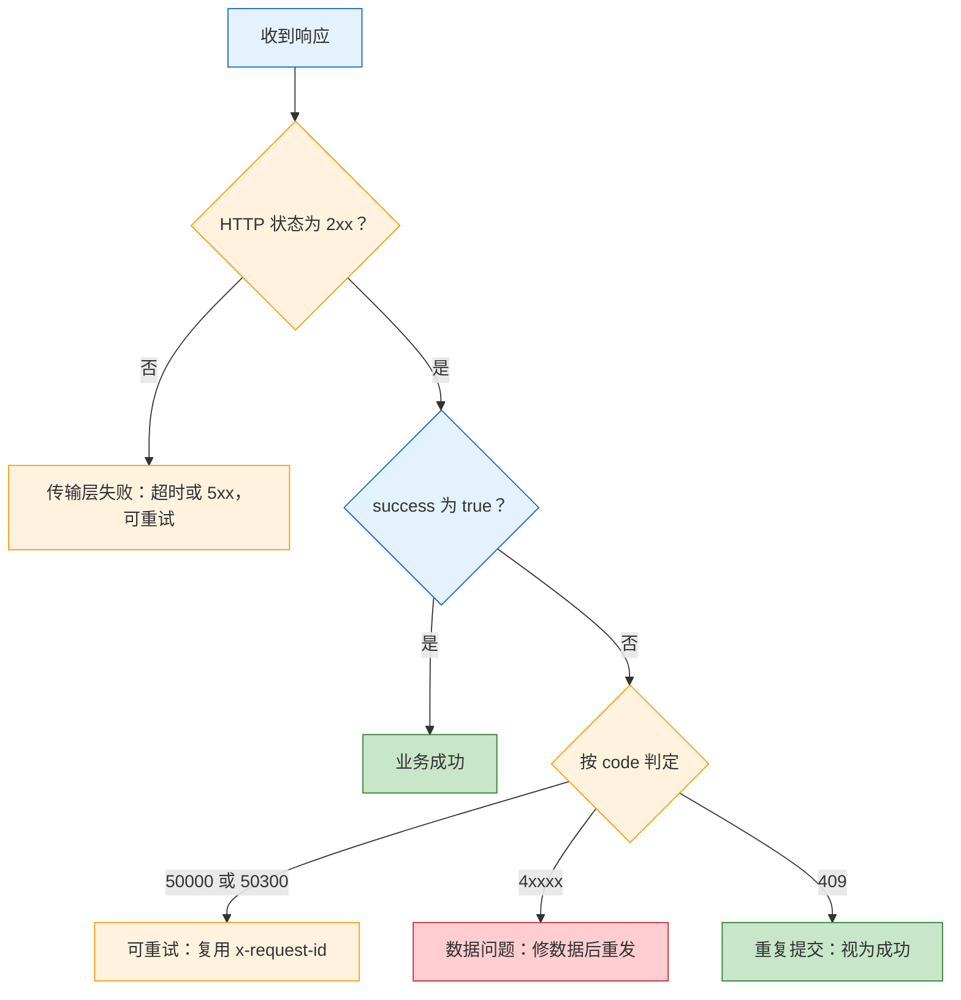

# MES 测试结果上传接口协议 V1.3（定稿）

|  |  |
|:---:|:---:|
| **版本** | V1.3 |
| **日期** | 2026-11-18 |
| **状态** | 定稿 |
| **适用对象** | 测试机台客户端 / MES 服务端对接开发 |

> **总览说明：** `result` 字段类型为 object、允许 null，当前实际返回 null；**内网免认证**，不携带 Authorization；请求体所有 string 字段禁止 null，空值统一用 `/` 代替；服务端按字符串原样接收，不做数字、布尔或时间解析。

---

## 目录

- [1. 概述](#1-概述)
- [2. 请求头](#2-请求头)
- [3. 请求体](#3-请求体)
  - [3.1 结构](#31-结构)
  - [3.2 顶层字段](#32-顶层字段)
  - [3.3 明细对象（details 元素）](#33-明细对象details-元素)
  - [3.4 请求体示例](#34-请求体示例)
- [4. 数据校验约定（客户端约束）](#4-数据校验约定客户端约束)
- [5. 响应体](#5-响应体)
  - [5.1 结构（四项）](#51-结构四项)
  - [5.2 字段定义](#52-字段定义)
  - [5.3 业务码码表（占位，以服务端最终为准）](#53-业务码码表占位以服务端最终为准)
  - [5.4 成功响应示例](#54-成功响应示例)
  - [5.5 失败响应示例](#55-失败响应示例)
- [6. 判定规则](#6-判定规则)
- [7. 重试与幂等](#7-重试与幂等)
- [8. 待确认事项](#8-待确认事项)

---

## 1. 概述

| 项 | 内容 |
|---|---|
| 接口名称 | 测试结果上传 |
| 请求方法 | **POST** |
| 请求路径 | `/api/v1/test-results`（以实际部署为准） |
| 请求 Content-Type | `application/json; charset=UTF-8` |
| 响应 Content-Type | `application/json; charset=UTF-8` |
| 字符编码 | UTF-8 |
| 认证 | **内网免认证**，不携带 Authorization |

---

## 2. 请求头

| 请求头 | 必填 | 示例 | 说明 |
|---|:---:|---|---|
| `Content-Type` | **是** | `application/json; charset=UTF-8` | 固定 JSON |
| `Accept` | 否 | `application/json` | 期望响应 JSON |
| `x-device-sn` | **是** | `71202011752609010004567V8083` | 设备 SN，便于网关索引/校验 |
| `x-timestamp` | **是** | `1745310935000` | 请求时间戳，毫秒值、秒级取整，13 位数字字符串 |
| `x-request-id` | **是** | `a1b2c3d4e5f67890abcdef1234567890` | 请求唯一 ID（32 位无连字符 UUID），重试时保持不变，用于追踪与幂等 |

**约定：**

- `x-timestamp` 保持现有实现：向下取整到秒；服务端按毫秒解析，校验与本地时间差不超过 5 分钟。
- `x-device-sn` 应与请求体 `barcode` 一致（如服务端做一致性校验）。
- `x-request-id` 为**幂等键**，客户端超时重试必须复用同一值。

时间戳取整规则保持现有实现，示意如下：

```
x-timestamp = floor(当前毫秒时间戳 / 1000) * 1000     // 结果仍为 13 位毫秒字符串
服务端校验：|服务端时间 - x-timestamp| <= 5 分钟
```

---

## 3. 请求体

### 3.1 结构

```json
{
  "station": "string",
  "componentcode": "string",
  "traycode": "string",
  "barcode": "string",
  "programname": "string",
  "programversion": "string",
  "testexecutetime": "string",
  "testlongtime": "string",
  "result": "string",
  "details": [ { /* 明细对象 */ } ],
  "isfinalreport": "string"
}
```

### 3.2 顶层字段

字段顺序与 `design_data/MesFormat/mesUploadTestDataFormat.json` 保持一致。

| 字段 | 类型 | 必填 | 示例 | 说明 |
|---|:---:|:---:|---|---|
| `station` | string | **是** | `39C0-L2-1F-DIP16-FCT01` | 工位/测试站编号 |
| `componentcode` | string | **是** | `L120201091` | 型号码 |
| `traycode` | string | 否 | `T02001` | 托盘码；无值时传 `/` 或空串，服务端存空串 |
| `barcode` | string | **是** | `71202011752609010004567V8083` | 产品条码（被测件唯一标识） |
| `programname` | string | **是** | `TEST-DUT-001` | 测试程序名称 |
| `programversion` | string | **是** | `V0.0.2` | 测试程序版本 |
| `testexecutetime` | string | **是** | `2025/4/22 13:55:35.123` | 测试开始时间，格式 `yyyy/M/d HH:mm:ss.SSS` |
| `testlongtime` | string | **是** | `00:00:06.300` | 总耗时，格式 `HH:mm:ss.SSS` |
| `result` | string | **是** | `FAIL` | 整单测试结论，枚举 `PASS` / `FAIL` |
| `details` | array | **是** | `[...]` | 测试明细列表，不得为 null，至少 1 个元素 |
| `isfinalreport` | string | **是** | `false` | 是否最终报告，`true` / `false` |

### 3.3 明细对象（details 元素）

| 字段 | 类型 | 必填 | 示例 | 说明 |
|---|:---:|:---:|---|---|
| `TestItem` | string | **是** | `测试温度` | 测试项目名称 |
| `TestStep` | string | **是** | `SOC_HW_ID2` | 测试步骤/子项名称 |
| `StandardValue` | string | **是** | `1.10` | 标准值（字符串原样） |
| `UpperValue` | string | **是** | `1.20` | 上限值（字符串原样） |
| `LowerValue` | string | **是** | `0.90` | 下限值（字段名即 `LowerValue`，字符串原样） |
| `MeasureValue` | string | **是** | `1.22` | 实测值（字符串原样） |
| `TestResult` | string | **是** | `false` | 单项判定，枚举 `"true"` / `"false"` |
| `TestBeginTime` | string | **是** | `13:55:35.123` | 步骤开始时间 `HH:mm:ss.SSS`（无日期） |
| `TestEndTime` | string | **是** | `13:55:37.123` | 步骤结束时间 `HH:mm:ss.SSS`（无日期） |

### 3.4 请求体示例

```json
{
  "station": "39C0-L2-1F-DIP16-FCT01",
  "componentcode": "L120201091",
  "traycode": "T02001",
  "barcode": "71202011752609010004567V8083",
  "programname": "TEST-DUT-001",
  "programversion": "V0.0.2",
  "testexecutetime": "2025/4/22 13:55:35.123",
  "testlongtime": "00:00:06.300",
  "result": "FAIL",
  "isfinalreport": "true",
  "details": [
    {
      "TestItem": "测试温度",
      "TestStep": "SOC_HW_ID1",
      "StandardValue": "1.10",
      "UpperValue": "1.20",
      "LowerValue": "0.90",
      "MeasureValue": "1.12",
      "TestResult": "true",
      "TestBeginTime": "13:55:35.123",
      "TestEndTime": "13:55:37.123"
    },
    {
      "TestItem": "测试温度",
      "TestStep": "SOC_HW_ID2",
      "StandardValue": "1.10",
      "UpperValue": "1.20",
      "LowerValue": "0.90",
      "MeasureValue": "1.22",
      "TestResult": "false",
      "TestBeginTime": "13:55:38.423",
      "TestEndTime": "13:55:41.423"
    }
  ]
}
```

---

## 4. 数据校验约定（客户端约束）

1. **禁止 null：** 请求体所有 string 字段（含 `station`、`testexecutetime`、`barcode`、`result`、`testlongtime`、`programname`、`programversion` 及 `details` 内全部字段）禁止 null。
2. **空值用 `/`：** 无值时一律用 `/` 代替。
3. **服务端不解析：** 服务端对上述字段均按字符串原样接收与存储，不解析为数字、布尔或时间。
4. **details 非空：** `details` 数组不得为 null，至少包含 1 个明细对象。
5. **判定责任在客户端：** 顶层 `result` 与明细 `TestResult` 由客户端判定生成，MES 不做二次校验；客户端应保证其为合法值（`PASS` / `FAIL`、`"true"` / `"false"`），异常时用 `/` 占位。
6. **关键字段建议：** `barcode`、`station`、`testexecutetime` 为业务关键字段，客户端发送前应做非空校验，为空直接拦截报错，不建议用 `/` 兜底发送。

> **注意：** `/` 仅用于普通字段的空值占位；关键字段为空时必须拦截，不得兜底上报。

---

## 5. 响应体

### 5.1 结构（四项）

```json
{
  "success": true,
  "message": "success",
  "code": 0,
  "result": null
}
```

### 5.2 字段定义

| 字段 | 类型 | 必返 | 示例 | 说明 |
|---|:---:|:---:|---|---|
| `success` | bool | **是** | `true` | 业务是否成功 |
| `message` | string | **是** | `success` | 提示信息，失败时给出原因 |
| `code` | int | **是** | `0` | 业务状态码（码表见 5.3） |
| `result` | object（可为 null） | **是** | `null` | 结果附加数据。字段类型为 object，允许 null，当前实际返回 null。将来若有结构化数据，返回 object，客户端需同时容忍 null 与 object 两种形态，并容忍未知字段 |

> **JSON Schema 语义：** `result` 仅允许 object 或 null，不允许 string / array / number / bool；客户端解析时必须同时容忍 null 与 object，并忽略未知字段。

### 5.3 业务码码表（占位，以服务端最终为准）

| code | 含义 | 客户端是否重试 |
|:---:|---|:---:|
| `0` | 成功 | — |
| `40001` | 参数校验失败（`barcode` 为空、格式错误等） | 否，修数据 |
| `40002` | 明细数据非法 | 否，修数据 |
| `40003` | 设备 SN 与 `barcode` 不一致 | 否，修数据 |
| `409` | 重复提交（request-id 已处理） | 否，视为成功 |
| `50000` | 服务端内部错误 | **是** |
| `50300` | 服务繁忙/超时 | **是** |

内网免认证场景不实现认证类错误码；服务端已实现码表：`0` 成功 / `40001` 参数错误 / `40002` 明细非法 / `40003` SN 与 barcode 不一致 / `409` 重复提交（视为成功）/ `50000` 内部错误。

### 5.4 成功响应示例

```json
{
  "success": true,
  "message": "success",
  "code": 0,
  "result": null
}
```

### 5.5 失败响应示例

```json
{
  "success": false,
  "message": "barcode 不能为空",
  "code": 40001,
  "result": null
}
```

---

## 6. 判定规则

1. **HTTP 层：** HTTP 非 2xx → 传输层失败，可重试（超时 / 5xx）。
2. **业务层：** HTTP 2xx 后看 `success`：
   - `success == true` → 成功。
   - `success == false` → 失败，按 `code` 决定是否重试（见码表）。
3. **判定责任：** 单项通过性与整单结论由客户端生成；MES 仅按字符串接收存储，不做数值比较或枚举校验。

完整判定流程如下：



---

## 7. 重试与幂等

| 场景 | 是否重试 | 说明 |
|---|:---:|---|
| 网络异常 / 超时 / HTTP 5xx | **是** | 复用同一 `x-request-id` |
| `code=50000` / `50300` | **是** | 复用同一 `x-request-id` |
| `code=4xxxx` | 否 | 数据问题，修后重发 |
| `code=409`（重复提交） | 否 | 视为成功 |

- **幂等键：** `x-request-id`，重试时保持不变。
- 建议重试次数不超过 3 次，退避间隔 `1s / 2s / 3s`。

> **注意：** 4xxxx 属于数据问题，重试不会改变结果；必须先修正数据再重新提交。

---

## 8. 待确认事项

- [x] 请求路径已落地：`POST /api/v1/test-results`（域名按实际部署，默认 `http://<服务器内网IP>:8000`）。
- [x] `code` 码表已实现（见 5.3）。

---

*来源说明：MES 测试结果上传接口协议 V1.3（定稿） | 2026-11-18*
