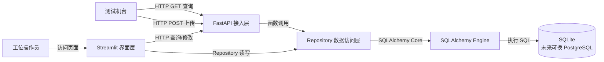

markdown

# 系统框架设计

## 一、架构图

测试机台
  ├─ HTTP POST 上传 ──> FastAPI 接入层
  └─ HTTP GET 查询 ──> FastAPI 接入层

工位操作员 ──访问页面──> Streamlit 界面层
Streamlit 界面层 ──Repository 读写──> Repository 数据访问层
Streamlit 界面层 ──HTTP 查询/修改──> FastAPI 接入层（兼容保留）

FastAPI 接入层 ──函数调用──> Repository 数据访问层
Repository 数据访问层 ──SQLAlchemy Core──> SQLAlchemy Engine
SQLAlchemy Engine ──执行 SQL──> SQLite（未来可换 PostgreSQL）

## 二、分层说明

| 层级       | 组件              | 职责                                                     |
| ---------- | ----------------- | -------------------------------------------------------- |
| 接入层     | FastAPI           | 主要给机台使用：上传/查询/程序拉取/放行/变量；参数校验、错误处理，不写 SQL |
| 界面层     | Streamlit         | 内部管理工具：可直接通过 Repository 读写数据库（看板已如此），也可经 HTTP 调 FastAPI |
| 数据访问层 | Repository        | 唯一写 SQL 的地方，用 SQLAlchemy Core 构造语句，管理事务 |
| 存储适配层 | SQLAlchemy Engine | 连接管理、方言适配、事务控制                             |
| 存储层     | SQLite            | 当前存储实现，未来可迁移到 PostgreSQL                    |

## 三、核心原则

1. **FastAPI 主要给机台使用**：机台的上传/查询/程序拉取/放行查询/变量读写都走 FastAPI；FastAPI 不写 SQL，统一经 Repository 访问数据库。
2. **Repository 是唯一写 SQL 的地方**：上层不感知 SQLAlchemy 的存在。
3. **Streamlit 也能通过 Repository 读写数据库**：作为内部管理工具，Streamlit 可直接调用 Repository 读写数据（不写 SQL、不感知 SQLAlchemy），例如看板直读 station_summary；也可以经 HTTP 调用 FastAPI。
4. **机台只读**：修改仅由操作员通过 Streamlit 触发。
5. **换数据库只影响底层**：连接配置和 Repository 内部变化，其余层不变。

## 四、数据库约定（补充）

测试数据和产品流转数据与主数据分离，详细约定见：

- [测试报告数据库约定](../DatabaseConventions/测试报告数据库约定.md)：按工序分库 `db_<工序号>.db`；`report_index` + 每产品明细表 `SN_<条码>_<hash>`。
- [产品流转数据库约定](../DatabaseConventions/产品流转数据库约定.md)：`ProductFlow.db`；`product_overview` + 每产品流转表 `F_<条码>_<hash>`。

当前代码尚未完全按上述约定实现；文档作为后续实现依据。
