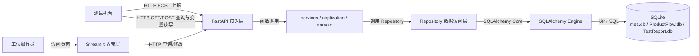

# 系统框架设计

## 一、架构图

## 二、分层说明

| 层级 | 组件 | 职责 |
| --- | --- | --- |
| 接入层 | FastAPI | 同时服务设备和 UI：设备接口在 `routers/device`，UI 接口在 `routers/ui`，双方共用接口在 `routers/common` |
| 界面层 | Streamlit | 内部管理工具；只通过 `ui/client.py` 经 HTTP 调 FastAPI，不直接访问 Repository 或数据库 |
| 服务层 | services | 业务入口、输入校验、异常转换 |
| 用例层 | application | 多步骤业务编排：测试上报、入站、解绑、解锁、程序状态 |
| 领域层 | domain | 纯业务规则，不依赖 FastAPI / Streamlit / SQLAlchemy / sqlite3 |
| 数据访问层 | Repository | 唯一写 SQL 的地方，用 SQLAlchemy Core 构造语句 |
| 存储适配层 | SQLAlchemy Engine | 连接管理、方言适配、WAL / busy_timeout 等 SQLite 参数 |
| 存储层 | SQLite | `mes.db`、`ProductFlow.db`、`TestReport.db` |

## 三、核心原则

1. **FastAPI 同时服务设备和 UI**：路由按调用方分为 `routers/device`、`routers/ui`、`routers/common`，但 URL 保持稳定。
2. **Repository 是唯一写 SQL 的地方**：上层不感知 SQLAlchemy。
3. **Streamlit 只能经 HTTP 访问 FastAPI**：UI 不允许直接 import Repository、engine、SQLAlchemy 或 sqlite3。
4. **设备负责上报，操作员负责维护**：设备上报测试/程序状态；主数据、入站、解绑、解锁等由操作员通过 Streamlit 触发。
5. **换数据库主要影响底层**：连接配置和 Repository 内部变化，其余层不变。

## 四、数据库约定（补充）

测试数据和产品流转数据与主数据分离，详细约定见：

- [测试报告数据库约定](../DatabaseConventions/测试报告数据库约定.md)：统一 `TestReport.db`，库内按 `report_index_<step_no>` 分工序总览，明细表 `SN_<step>_<条码>_<hash>`。
- [产品流转数据库约定](../DatabaseConventions/产品流转数据库约定.md)：`ProductFlow.db` 维护 `product_overview` 和每产品流转历史；`mes.db.active_products` 维护当前在制产品。

当前代码已按上述约定实现。
