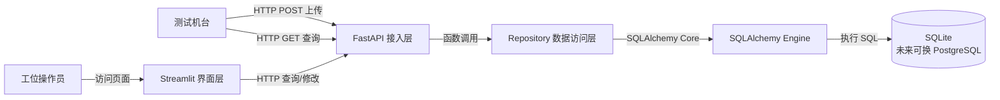

markdown

# 系统框架设计

## 一、架构图

测试机台
  ├─ HTTP POST 上传 ──> FastAPI 接入层
  └─ HTTP GET 查询 ──> FastAPI 接入层

工位操作员 ──访问页面──> Streamlit 界面层
Streamlit 界面层 ──HTTP 查询/修改──> FastAPI 接入层

FastAPI 接入层 ──函数调用──> Repository 数据访问层
Repository 数据访问层 ──SQLAlchemy Core──> SQLAlchemy Engine
SQLAlchemy Engine ──执行 SQL──> SQLite（未来可换 PostgreSQL）

## 二、分层说明

| 层级       | 组件              | 职责                                                     |
| ---------- | ----------------- | -------------------------------------------------------- |
| 接入层     | FastAPI           | 系统唯一数据入口，负责参数校验和错误处理，不写 SQL       |
| 界面层     | Streamlit         | 只做界面，通过 HTTP 调 FastAPI，不直接访问数据库         |
| 数据访问层 | Repository        | 唯一写 SQL 的地方，用 SQLAlchemy Core 构造语句，管理事务 |
| 存储适配层 | SQLAlchemy Engine | 连接管理、方言适配、事务控制                             |
| 存储层     | SQLite            | 当前存储实现，未来可迁移到 PostgreSQL                    |

## 三、核心原则

1. **FastAPI 是唯一数据入口**：机台上传/查询、Streamlit 查询/修改都走它。
2. **Repository 是唯一写 SQL 的地方**：上层不感知 SQLAlchemy 的存在。
3. **Streamlit 不碰数据库**：只通过 HTTP 调 FastAPI，与 Repository 无直接连线。
4. **机台只读**：修改仅由操作员通过 Streamlit 触发。
5. **换数据库只影响底层**：连接配置和 Repository 内部变化，其余层不变。
